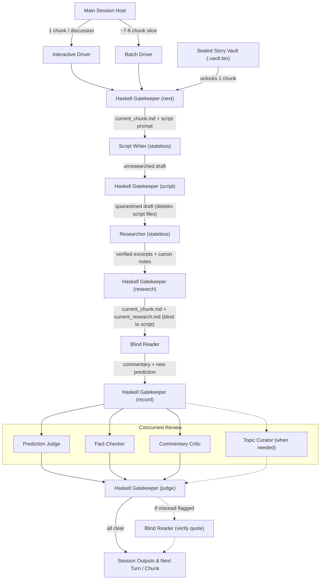

# Let's Read

An Antigravity plugin (`lets-read`) that conducts a genuine, spoiler-free,
chunk-by-chunk "Let's Read" liveblog of a story or book in `.txt`, `.md`,
`.markdown`, `.html`, or `.epub` format.

When you ask an AI assistant to liveblog a book normally, it either reads ahead
in the file or draws on spoilers from its training data. This plugin prevents
both by sealing the story inside an obfuscated archive controlled by a compiled
Haskell gatekeeper, routing session orchestration through dedicated interactive
and batch mode drivers so the main chat stays clean and bounded, and delegating
draft topic scouting, continuity/canon research, reading, prediction judging,
fact-checking, editorial critique, and topic indexing to seven isolated leaf
subagents that exchange data through predetermined session files.

## Prerequisites

The gatekeeper binary is compiled automatically on first use via [prepare.sh]
and requires:

- `bash`

- GHC (Glasgow Haskell Compiler) and the `zlib` Haskell package

[prepare.sh]: ./skills/lets-read/scripts/prepare.sh

## Installation

Validate and install the plugin from the repository root using the Antigravity
CLI (`agy`):

```bash
# Validate the plugin manifest, skill, and agent definitions
agy plugin validate --strict .

# Install the plugin into your local Antigravity environment
agy plugin install .

# Verify that the plugin is installed and enabled
agy plugin list
```

## Usage

Once installed, ask Antigravity to start a Let's Read of any `.txt`, `.md`,
`.markdown`, `.html`, or `.epub` file (or invoke `/lets-read`):

> Start a Let's Read of `~/Books/story.epub` in interactive mode using the
> Mystery & Theorycrafter persona.

### Interactive Mode (Default)

Advances one chunk at a time via the Interactive Driver, updates
`current_turn.md` in place so a pinned side preview tab refreshes automatically
each turn, posts a compact spoiler-free turn card with prediction verdict counts
and session links in chat (while relaying user discussion replies inline from
`last_discussion_exchange.md`, or full entries inline on request), and pauses so
you can discuss theories, ask questions, or say "continue" to unlock the next
chunk (rotating the driver lazily across chapter boundaries so context stays
bounded).

### Batch Mode

Autonomously reads a specified number of chunks or chapters (or the entire
work), delegating slices of ~7–8 chunks to fresh Batch Driver instances so
context stays bounded and concluding with a final retrospective wrapup round
when the story finishes.

### Reader Personas

You can specify any custom persona description or choose from the built-in
presets in [personas.md]:

- Classic Forum Liveblogger *(default)*

- Literary & Craft Analyst

- Mystery & Theorycrafter ("Charlie Day Corkboard")

- Snarky Riff-Track

- Cozy & Enthusiastic First-Timer

- Suspense & Dread Reader

- History & Folklore Buff

- Drama & Motives Watcher

[personas.md]: ./skills/lets-read/references/personas.md

## Session Output

By default, sessions are written to `./lets-read-sessions/<story-slug>/` (or any
directory you specify).

### Live Turn View

The pin-once view of the latest finalized chunk commentary, wrapup, or
discussion turn in `current_turn.md` (along with the latest user Q&A delta in
`last_discussion_exchange.md`), keeping Interactive Mode chat context compact
while your open preview tab updates in place.

### Master Liveblog

The complete, continuously updated liveblog in `lets_read_log.md`, containing
all commentary entries, reader discussions, prediction verdicts, and the final
retrospective.

### Individual Entries

Per-chunk commentary files (`entries/chunk_XXXX.md`) along with the post-story
wrapup and retrospective (`entries/wrapup.md`).

### Prediction Scoreboard

The final prediction scoreboard and Hall of Fame & Shame in
`predictions/hall_of_fame.md`, generated once all story chunks are judged.

### Multi-Layer Indices

Bounded chronological (`by_chronology.md`) and semantic topic (`by_topic.md`)
indices across `chunks/`, `entries/`, and `predictions/`.

### Reader Notebook

The blind reader's evolving unspoiled notebook (`memory.md`) of characters,
factions, plot threads, and active mysteries.

## How It Works

The diagram below shows how the main host delegates to the Interactive Driver or
Batch Driver, and how each driver coordinates the Haskell gatekeeper and leaf
subagents across the per-chunk loop:



### Haskell Gatekeeper

Implemented in [LetsRead.hs]. Splits the source story into chapter-aware chunks,
seals them inside the session vault, unlocks strictly one chunk at a time,
enforces script quarantine and receipt verification, and manages all session
state, prediction scoreboards, and bounded multi-layer indices.

### Interactive Driver

Defined in [lets-read-interactive-driver.md]. Sits behind the main session host
in Interactive Mode to execute one reading chunk, Final Wrapup, or user
discussion turn per request via the shared [driver-pipeline.md] protocol,
keeping persistent leaf subagents warm while waiting for user discussion and
returning a 1-line file pointer so orchestration stays out of the user's chat.

### Batch Driver

Defined in [lets-read-batch-driver.md]. Autonomously drives slices of ~7–8
story chunks (plus the Final Wrapup when finishing the story) using the same
[driver-pipeline.md] protocol, then terminates its child subagents so context
stays bounded across book-length works.

### Script Writer

Defined in [lets-read-script-writer.md]. Runs as a stateless, persona-matched
first-pass reader on each unlocked chunk (and before the Final Wrapup) to
surface the callbacks, predictions, and canon comparisons the persona naturally
reaches for; its draft is consumed solely to build the research prompt and is
deleted before the blind reader runs.

### Researcher

Defined in [lets-read-researcher.md]. Collects receipt-verified verbatim
excerpts from earlier story chunks, prior commentary entries, and prediction
records—plus spoiler-safe external canon checks—relevant to what the script
writer touched, producing a neutral reference packet without ever revealing the
draft to the blind reader.

### Blind Reader

Defined in [lets-read-blind-reader.md]. Reads each newly unlocked passage
alongside the verified reference packet (completely blind to the script writer's
draft and without access to future chapters). It reacts in character in the
session's active persona, stakes one new falsifiable prediction per chunk, and
maintains an evolving notebook (`memory.md`).

### Prediction Judge

Defined in [lets-read-prediction-judge.md]. Evaluates all active predictions
impartially against each newly unlocked chunk, ruling predictions as
`CONFIRMED`, `DEBUNKED`, `SUBVERTED`, or `ACTIVE` with direct textual evidence.

### Fact-Checker

Defined in [lets-read-fact-checker.md]. Audits concrete factual and
chronological claims in the reader's commentary against unlocked story chunks
and primary sources. When it catches a material misread, the gatekeeper pauses
progression so the reader can verify the quote and respond in a peer discussion
turn before the next chunk unlocks.

### Commentary Critic

Defined in [lets-read-commentary-critic.md]. Reviews how well each entry
inhabited the chosen persona and user style directives, writing concise
editorial notes for the reader to apply on the next chunk.

### Topic Curator

Defined in [lets-read-topic-curator.md]. Runs on demand when new topic tags
accumulate, consolidating synonyms, character or faction aliases, and overly
narrow scene tags across the session's topic indices.

[LetsRead.hs]: ./skills/lets-read/scripts/LetsRead.hs
[driver-pipeline.md]: ./skills/lets-read/references/driver-pipeline.md
[lets-read-interactive-driver.md]: ./agents/lets-read-interactive-driver.md
[lets-read-batch-driver.md]: ./agents/lets-read-batch-driver.md
[lets-read-script-writer.md]: ./agents/lets-read-script-writer.md
[lets-read-researcher.md]: ./agents/lets-read-researcher.md
[lets-read-blind-reader.md]: ./agents/lets-read-blind-reader.md
[lets-read-prediction-judge.md]: ./agents/lets-read-prediction-judge.md
[lets-read-fact-checker.md]: ./agents/lets-read-fact-checker.md
[lets-read-commentary-critic.md]: ./agents/lets-read-commentary-critic.md
[lets-read-topic-curator.md]: ./agents/lets-read-topic-curator.md

## License

This project is licensed under the [MIT License].

[MIT License]: ./LICENSE
