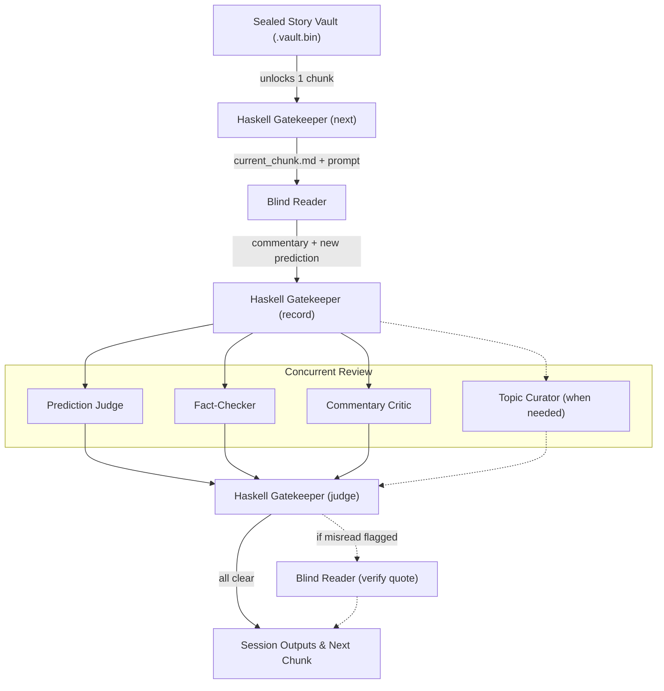

# Let's Read

An Antigravity plugin (`lets-read`) that conducts a genuine, spoiler-free,
chunk-by-chunk "Let's Read" liveblog of a story or book in `.txt`, `.md`,
`.markdown`, `.html`, or `.epub` format.

When you ask an AI assistant to liveblog a book normally, it either reads ahead
in the file or draws on spoilers from its training data. This plugin prevents
both by sealing the story inside an obfuscated archive controlled by a compiled
Haskell gatekeeper and delegating the reading, prediction judging,
fact-checking, editorial critique, and topic indexing to five isolated
subagents that exchange data through predetermined session files.

## Prerequisites

The gatekeeper binary is compiled automatically on first use via
[prepare.sh](./skills/lets-read/scripts/prepare.sh) and requires:

- `bash`

- GHC (Glasgow Haskell Compiler) and the `zlib` Haskell package

## Installation

Validate and install the plugin from the repository root using the Antigravity
CLI (`agy`):

```bash
# Validate the plugin manifest, skill, and agent definitions
agy plugin validate --strict .

# Install the plugin into your local Antigravity environment
agy plugin install .

# Verify that the plugin is installed and enabled
agy plugin list
```

## Usage

Once installed, ask Antigravity to start a Let's Read of any `.txt`, `.md`,
`.markdown`, `.html`, or `.epub` file (or invoke `/lets-read`):

> Start a Let's Read of `~/Books/story.epub` in interactive mode using the
> Mystery & Theorycrafter persona.

### Interactive Mode (Default)

Reads one chunk at a time, presents the reader's commentary and the judge's
prediction verdicts in chat, and pauses so you can discuss theories, ask
questions, or say "continue" to unlock the next chunk.

### Batch Mode

Autonomously reads a specified number of chunks or chapters (or the entire
work), processing long works in batches so context stays bounded and concluding
with a final retrospective wrapup round when the story finishes.

### Reader Personas

You can specify any custom persona description or choose from the built-in
presets in [personas.md](./skills/lets-read/references/personas.md):

- Classic Forum Liveblogger *(default)*

- Literary & Craft Analyst

- Mystery & Theorycrafter ("Charlie Day Corkboard")

- Snarky Riff-Track

- Cozy & Enthusiastic First-Timer

## Session Output

By default, sessions are written to `./lets-read-sessions/<story-slug>/` (or
any directory you specify).

### Master Liveblog

The complete, continuously updated liveblog in `lets_read_log.md`, containing
all commentary entries, reader discussions, prediction verdicts, and the final
retrospective.

### Individual Entries

Per-chunk commentary files (`entries/chunk_XXXX.md`) along with the post-story
wrapup and retrospective (`entries/wrapup.md`).

### Prediction Scoreboard

The final prediction scoreboard and Hall of Fame & Shame in
`predictions/hall_of_fame.md`, generated once all story chunks are judged.

### Multi-Layer Indices

Bounded chronological (`by_chronology.md`) and semantic topic (`by_topic.md`)
indices across `chunks/`, `entries/`, and `predictions/`.

### Reader Notebook

The blind reader's evolving unspoiled notebook (`memory.md`) of characters,
factions, plot threads, and active predictions.

## How It Works

The diagram below shows how control and session files flow through the
per-chunk loop (orchestrated by the host session):



### Haskell Gatekeeper

Implemented in [LetsRead.hs](./skills/lets-read/scripts/LetsRead.hs). Splits the
source story into chapter-aware chunks, seals them inside the session vault,
unlocks strictly one chunk at a time, and manages all session state, prediction
scoreboards, and bounded multi-layer indices.

### Blind Reader

Defined in [blind-reader.md](./agents/blind-reader.md). Reads each newly
unlocked passage without access to future chapters or the source file. It reacts
in character in the session's active persona, stakes one new falsifiable
multi-chapter prediction per chunk, and maintains an evolving notebook
(`memory.md`).

### Prediction Judge

Defined in [prediction-judge.md](./agents/prediction-judge.md). Evaluates all
active predictions impartially against each newly unlocked chunk, ruling
predictions as `CONFIRMED`, `DEBUNKED`, `SUBVERTED`, or `ACTIVE` with direct
textual evidence.

### Fact-Checker

Defined in [fact-checker.md](./agents/fact-checker.md). Audits concrete factual
and chronological claims in the reader's commentary against unlocked story
chunks and primary sources. When it catches a material misread, the gatekeeper
pauses progression so the reader can verify the quote and respond in a peer
discussion turn before the next chunk unlocks.

### Commentary Critic

Defined in [commentary-critic.md](./agents/commentary-critic.md). Reviews how
well each entry inhabited the chosen persona and user style directives, writing
concise editorial notes for the reader to apply on the next chunk.

### Topic Curator

Defined in [topic-curator.md](./agents/topic-curator.md). Runs on demand when
new topic tags accumulate, consolidating synonyms, character or faction aliases,
and overly narrow scene tags across the session's topic indices.

## License

This project is licensed under the [MIT License](./LICENSE).
